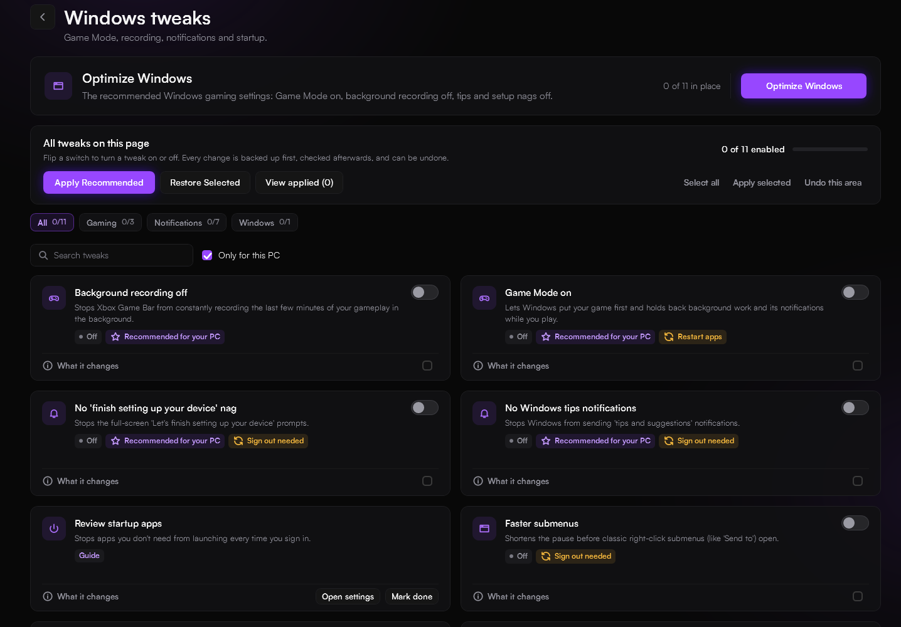
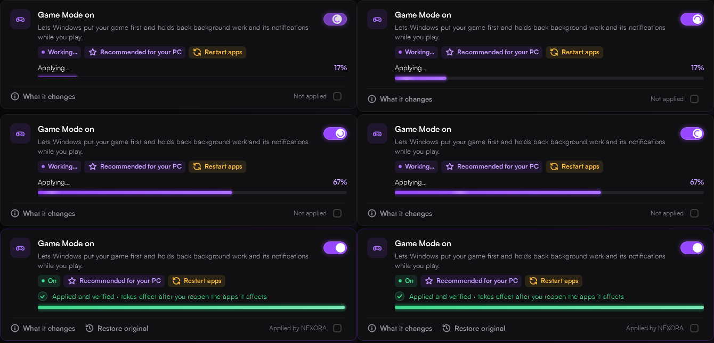

# NEXORA

**A free Windows 11 optimizer for gamers and everyday PCs — where every change is backed up, checked, and undoable.**

[**⬇ Download the latest version**](https://github.com/Gubbylord/nexora/releases/latest)

## What it does

NEXORA tunes Windows for smoother games and lower input lag using researched, documented tweaks — and explains every one in plain words before you change anything.

- **One switch per tweak.** Flip it on, watch it back up your setting, apply the change and verify it worked. Flip it off and your *original* value comes back — not a guess at the Windows default.
- **Recommended for your PC.** NEXORA reads your hardware (CPU, GPU, RAM, drives, display, laptop or desktop) and only recommends what fits. Tweaks that don't apply to your PC are clearly marked.
- **Every area covered:** CPU, GPU (NVIDIA / AMD / Intel guides), RAM, BIOS guides, drives, power, Windows, privacy, network and input lag.
- **Game library + Game Boost.** Finds your Steam, Epic, Xbox, Riot, Roblox and Minecraft games, launches them with temporary optimizations, and undoes them when you quit.
- **One-click Debloat.** Simple Windows 10 and Windows 11 buttons remove only researched, safe bloatware for your account — drivers, security, Xbox/Game Pass and your files are kept. You see the exact list and get a restore point first.
- **Hardware-matched presets.** One-click profiles from Low-End to High-End, plus a **Maximum Performance** profile — built only from tweaks that fit your PC, and fully reversible.
- **Live monitoring.** CPU / GPU / RAM / VRAM graphs, a real FPS counter and an in-game overlay (Alt+Shift+F), plus benchmarks that tell you whether a change actually helped.
- **Fixes page.** Spots risky changes other "optimizer" tools left behind and explains them.
- **Updates itself.** New versions download in the background and install when you close NEXORA.

## Safe by design

- **Backup before every change, check after every change.** If Windows doesn't keep a new value, NEXORA puts the old one back automatically.
- **Real progress only.** Progress bars show actual steps finished — never a fake timer.
- **Preview mode** shows exactly what would change without changing anything.
- **Never touches** Defender, the firewall, Windows Update, UAC, security mitigations or anti-cheat, and never injects into games.
- **No accounts, ads or telemetry.** Nothing is uploaded. The only internet use is the update check and network tests you start yourself.
- **Signed updates.** The app only installs updates signed with the publisher's private key, so nobody else can push a fake update.

## Install

1. Download **[`Nexora.exe`](https://github.com/Gubbylord/nexora/releases/latest/download/Nexora.exe)** from the latest release.
2. Put it wherever you like (for example a "NEXORA" folder in Documents) and double-click it.
3. Setup walks you through everything and changes nothing on its own.

It's a single file — no installer, no ZIP, no .NET download. After this first download, NEXORA keeps itself up to date.
(The `NEXORA-x.x.x-win-x64.zip` on the release page is the automatic-update package; you don't need it.)

> **Windows SmartScreen warning?** NEXORA isn't code-signed yet, so Windows may say it "protected your PC". Click **More info → Run anyway**.

## Requirements

- Windows 11 (64-bit)
- Administrator permission only for system-wide tweaks — Windows asks you once when it's needed

## FAQ

**Will this break my PC?**
Every change is backed up first and can be undone from the tweak's card or the Backups page. NEXORA also offers to create a Windows restore point during setup.

**Does it really raise FPS?**
It removes common causes of stutter and input lag. How much it helps depends on your PC — use the built-in benchmark to compare before and after instead of trusting promises.

**How do updates work?**
NEXORA checks for a new version in the background. It downloads it, verifies its signature, and installs it the next time you close the app. You can turn this off in Settings › Updates.

**Why can't I see my CPU temperature?**
Reading it needs a kernel driver, and NEXORA deliberately installs none.

## Known limits

- Tested most on Intel + NVIDIA desktops; AMD and laptop support is newer.
- The FPS counter covers DirectX games; some Vulkan/OpenGL games may show no FPS.

---

NEXORA is free software. Use at your own risk; every change can be undone.
